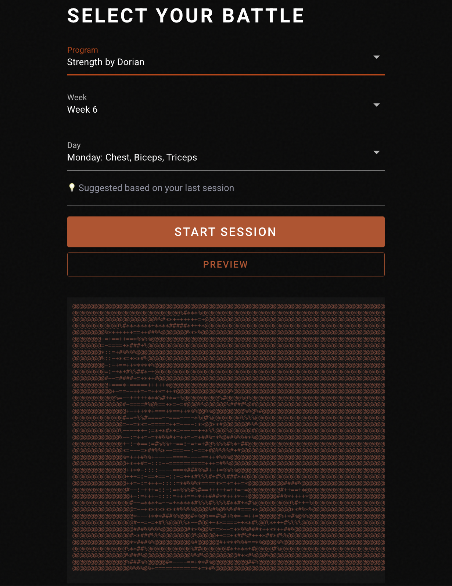
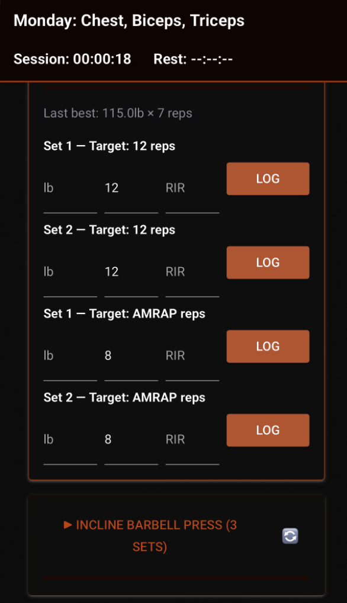
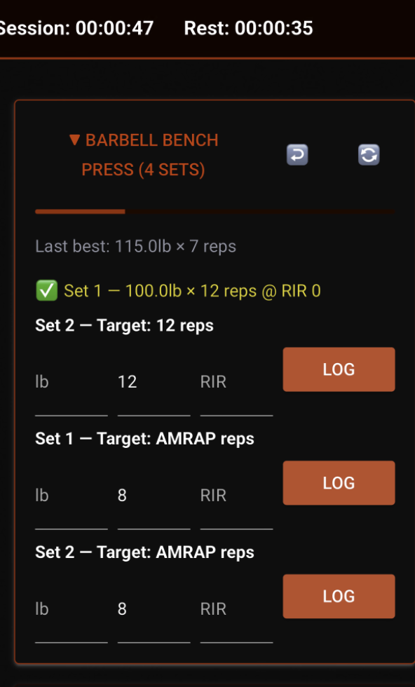
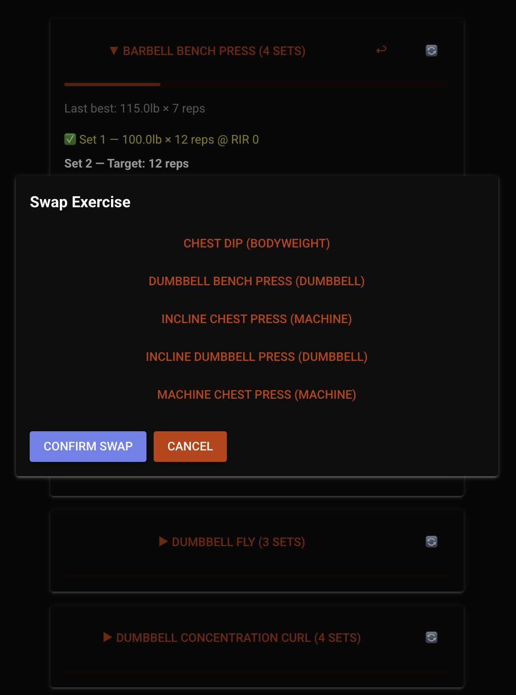
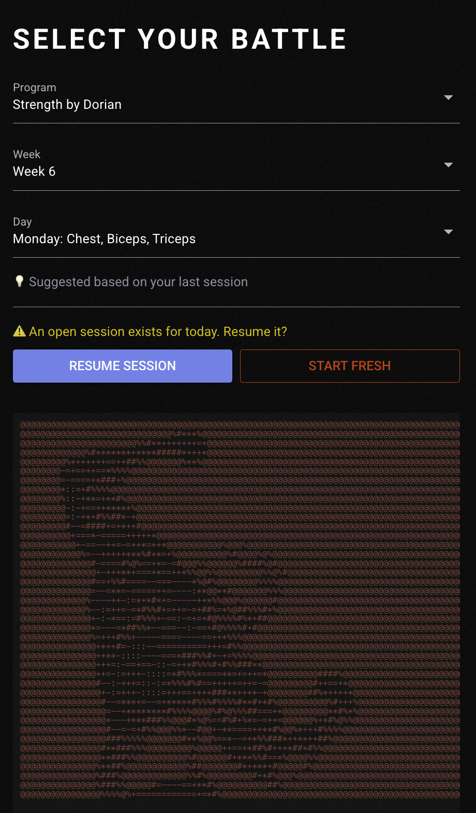

# Iron Arcade — Personal Workout Tracker

A personal workout logging app built and iterated from real daily gym use.
Imports training programs from spreadsheets, logs sets against a plan,
tracks rest time per exercise, and stores everything in PostgreSQL for analysis.

**Live app:** [iron-arcade.onrender.com](https://workout-tracker-tvgl.onrender.com)
_(single-user demo — logging writes to a real database)_

---

## Screenshots

|  |  |
|---|---|
| Program selector with ASCII art background | Logger with set inputs and logged set |

|  |  |
|---|---|
| Logged set showing rest timer, last best, progress bar | Swap exercise dialog with filtered candidates |


*Mobile view — session resume prompt with ASCII art*
---

## Why it exists

Commercial workout apps charge subscriptions. Most program content they sell
is also published free as spreadsheets on sites like Liftvault. I wanted:

- My own data in a database I control
- Rest time tracked per exercise, not just per session
- Analytics I could query and extend myself
- A learning project covering schema design, import pipelines, and deployment

---

## Two versions, one database

The app was built twice. Both versions share the same PostgreSQL schema and
import pipeline on Neon.

| | v1 — Streamlit | v2 — NiceGUI (current) |
|---|---|---|
| **Framework** | Streamlit 1.5 | NiceGUI 2.x + FastAPI |
| **Hosting** | Streamlit Community Cloud | Render.com |
| **Status** | Live, stable | Active development |
| **Branch** | `main`, `streamlit-stable` | `nicegui-rewrite` |

**Why two versions:** Streamlit reruns the entire script on every interaction.
During a workout this caused input lag and session loss on network drops.
NiceGUI uses a persistent WebSocket connection — only changed elements update,
so there are no page reloads while logging sets. A Reflex rewrite was also
attempted and abandoned (`reflex-rewrite` branch) due to strict typed
rendering constraints that made per-set input rows impractical to build.

---

## Features

- Program-based logging — import any training program from a flat CSV or Excel file
- Per-exercise rest timer — tracks time since last set of the same exercise only
- Session resumability — a crash or dropped connection restores from the database
- Exercise swap — replaces an exercise mid-session filtered by same muscle group and movement pattern
- Smart day suggestion — defaults to the next day based on last completed session
- PR detection — flags heavier weight or more reps at current top weight
- Set type labels — warmup (W1, W2), working (1, 2, 3), dropset (D1, D2)
- Workout preview — see all exercises before starting
- Analytics (v1) — load trend, rest interval chart, PR history per exercise
- IRON ARCADE theme — Bebas Neue font, program-specific ASCII art backgrounds, red accent

---

## Data model

Seven tables. The schema is shared across both versions.

```
exercises        — library of 70+ exercises with muscle group, equipment, movement pattern
exercise_aliases — 215 name variants mapping to canonical exercise names for import resolution
programs         — named program with source reference
program_days     — week/day structure with label
program_sets     — planned sets per exercise (target reps, RIR, % 1RM)
sessions         — one gym visit tied to a program day
logged_sets      — actual sets (weight_lb, reps, RIR, rest_secs, is_pr, set_type)
```

Key decisions: `weight_lb` throughout with no unit conversion.
`program_set_id` nullable in `logged_sets` to support ad-hoc sets.
Movement patterns use a horizontal/vertical split
(`push_horizontal`, `push_vertical`, `pull_horizontal`, `pull_vertical`,
`hinge`, `squat`, `isolation`) for accurate swap candidate filtering.

---

## Program import

Programs are imported from a flat CSV. One row per set.

```
week, day_num, day_label, exercise_name, set_num,
target_reps, target_rir, target_pct_1rm, notes
```

The importer resolves exercise names via canonical match first, then a 215-entry
alias table. It validates all names and runs inside a single transaction —
either the full program imports or nothing is written.

```bash
python import_program.py "PHAT" phat.csv --source "Liftvault - Layne Norton"
```

Programs imported: PHAT, Strength by Dorian, 5K Strengthening (in progress).

---

## Run locally

**v2 — NiceGUI**
```bash
git checkout nicegui-rewrite
python3.11 -m venv venv && source venv/bin/activate
pip install -r requirements.txt
python -c "from db import init_db; init_db()"
python seed.py && python seed_aliases.py
DATABASE_URL=your_neon_connection_string python nicegui_app/main.py
```

**v1 — Streamlit**
```bash
git checkout streamlit-stable
pip install -r requirements.txt
streamlit run app.py
```

SQLite is used locally by default. Set `DATABASE_URL` to point at Neon for
the full dataset.

---

## Deployment

| Component | Service | Cost |
|---|---|---|
| NiceGUI app | Render.com free tier | $0 |
| Streamlit app | Streamlit Community Cloud | $0 |
| PostgreSQL | Neon free tier | $0 |

Neon spins down after 5 minutes of inactivity. `pool_pre_ping=True` on the
SQLAlchemy engine handles the reconnect transparently. A 4-minute keepalive
timer fires inside the app to prevent cold starts during active sessions.

---

## Limitations

- Single-user, no authentication
- Analytics not yet ported to the NiceGUI version
- Exercise swap works only within the same muscle group and movement pattern
- First ever set for an exercise is incorrectly flagged as a PR (fix pending)
